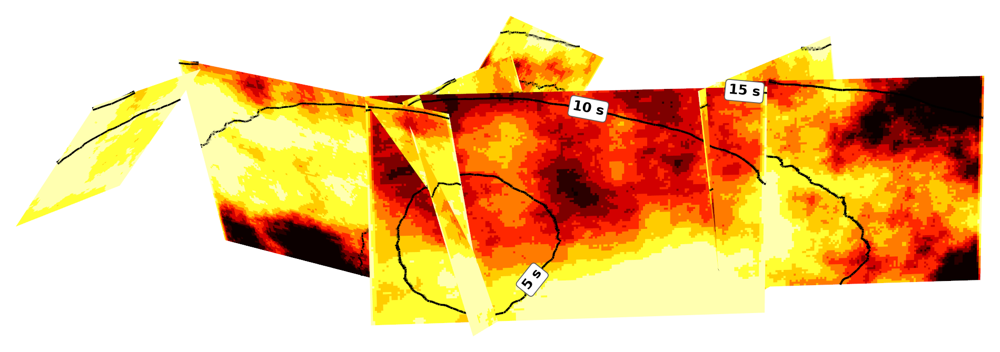
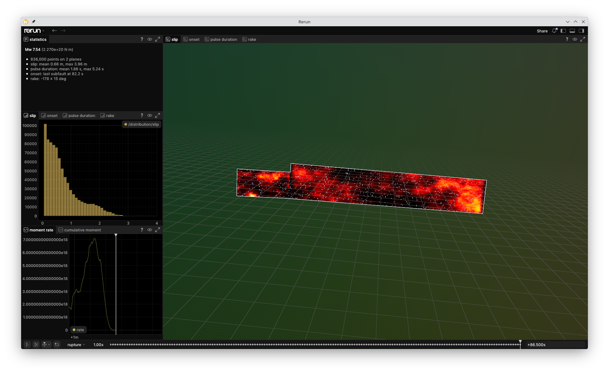
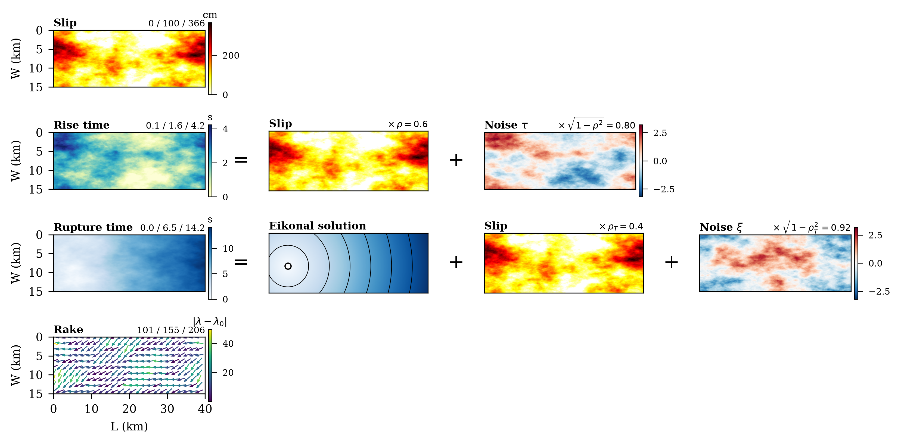

<!-- vale Google.Headings = NO -->
# Rupture Generator
<!-- vale Google.Headings = YES -->



*One draw of `examples/beavan.toml`: the 2010 Mw 7.1 Darfield earthquake on the seven
faults of [Beavan et al. (2012)](https://doi.org/10.1080/00288306.2012.697472),
gridded at 0.1 km and seen from the south at true scale. Darker is more slip, and the
black lines are the rupture front every five seconds. The rupture starts on the
Charing Cross fault and triggers the other six in a fixed order, each drawing its own
slip field and scaling it to its own magnitude. `just hero` draws it again.*

Kinematic rupture models for ground-motion simulation. Given a fault system and its
magnitudes, the generator draws a slip distribution and works out when each subfault
starts and how long it slips for. The result is an SRF, or a smaller file of the
fields that makes the same SRF later.

<!-- vale Google.Acronyms = NO -->
Built on the Graves and Pitarka generator
([2010](https://doi.org/10.1785/0120100057),
[2015](https://doi.org/10.1785/0220140101),
[2016](https://doi.org/10.1785/0120160088)), loosely based on the
[SCEC BBP platform](https://github.com/SCECcode/bbp).
<!-- vale Google.Acronyms = YES -->

---

## Build

The hot kernels are a Rust extension, built with
[setuptools-rust](https://github.com/PyO3/setuptools-rust). Requires Python 3.14 or
newer and a stable Rust toolchain.

```sh
uv sync                 # creates a venv and builds the Rust extension
uv sync --all-extras    # everything below too
```

| Extra   | Installs                      | Needed for              |
|---------|-------------------------------|-------------------------|
| `vis`   | rerun-sdk                     | `rupture-view`          |
| `test`  | pytest, hypothesis            | the test suite          |
| `bench` | pytest-benchmark              | `just bench`            |

---

## Quick start

```sh
uv run rupture-generator examples/alpine_hope.toml alpine_hope.srf
uv run rupture-view alpine_hope.srf
```

A rupture is one TOML file next to a GeoJSON fault system. The SRF's header comments
record the run: the config with every default written out, and the software and
inputs it ran with.

`examples/` holds past earthquakes and hazard-model scenarios, each with the source
of its fault geometry. Their parameters are illustrative: no example tunes them to
match the observations of its earthquake.

| Example            | Rupture                                  | Geometry from                                                                                                                                                            |
|--------------------|------------------------------------------|--------------------------------------------------------------------------------------------------------------------------------------------------------------------------|
| `landers.toml`     | 1992 Mw 7.28 Landers earthquake          | [Wald and Heaton (1994)](https://doi.org/10.1785/BSSA0840030668), SRCMOD s1992LANDER01WALD                                                                               |
| `northridge.toml`  | 1994 Mw 6.8 Northridge earthquake        | [Wald, Heaton and Hudnut (1996)](https://doi.org/10.1785/BSSA08601BS49), SRCMOD s1994NORTHR01WALD                                                                       |
| `beavan.toml`      | 2010 Mw 7.1 Darfield earthquake          | [Beavan et al. (2012)](https://doi.org/10.1080/00288306.2012.697472)                                                                                                     |
| `colombia.toml`    | 2026 Mw 7.4 San José del Palmar, Colombia, earthquake, intermediate depth | USGS finite-fault model [us6000tjl2](https://earthquake.usgs.gov/earthquakes/eventpage/us6000tjl2/finite-fault), trimmed as [Somerville et al. (1999)](https://doi.org/10.1785/gssrl.70.1.59) trim one, down to the hypocentre |
| `venezuela.toml`   | 2026 Mw 7.5 Catia La Mar, Venezuela, earthquake | USGS finite-fault model [us6000t7zp](https://earthquake.usgs.gov/earthquakes/eventpage/us6000t7zp/finite-fault), its two segments trimmed as [Somerville et al. (1999)](https://doi.org/10.1785/gssrl.70.1.59) trim one |
| `alpine_hope.toml` | Alpine-Hope Mw 8.31 scenario, rupture 71072 of the 2022 NZ NSHM | [Gerstenberger et al. (2024)](https://doi.org/10.1785/0120230165), on the NZ Community Fault Model v1.0 of [Seebeck et al. (2024)](https://doi.org/10.1080/00288306.2023.2181362) |

A finite-fault model's inversion grid reaches well past where the earthquake slipped,
so the Colombia and Venezuela planes keep only the part Somerville et al.'s rule
keeps: edge rows and columns go while their mean slip is under 30% of the rest's.

`crustal.toml` is a scenario Mw 6.2 on the Hope fault, and `two_faults.toml` and
`two_faults_segments.toml` are small made-up systems for testing.

`examples/from_realisation.py` converts a [workflow](https://github.com/ucgmsim/workflow) `realisation.json` into inputs for this repository.

---

## Command line

| Command                                   | Effect                                            |
|-------------------------------------------|---------------------------------------------------|
| `rupture-generator rupture.toml out.srf`  | Draw a rupture and write its SRF                  |
| `rupture-generator rupture.toml out.h5`   | Draw a rupture and write its fields, `.h5` or `.nc` |
| `rupture-generator fields.h5 out.srf`     | Write the SRF of a stored draw                     |
| `rupture-view out.srf`                    | Watch the rupture in Rerun, with the `vis` extra  |
| `rupture-view out.srf --save out.rrd`     | Save a Rerun recording instead                    |

A fields file is a fraction of the SRF's size, because the slip-rate series follow from
slip, rise time, and the pulse's rising fraction. Its SRF has the same points, byte
for byte, as one written straight from the draw.

The rupture viewer can be used to see an interactive 3D visualisation of a generated rupture.



*`rupture-view` on the Venezuela example, the two segments of the 2026 Mw 7.5 Catia
La Mar earthquake's finite-fault model, 86.5 s in, once every subfault has slipped.
Slip builds up on `hot` as each subfault's pulse runs, while the panels on the left
give the rupture's statistics, the distribution of slip so far, and the moment rate.
The tabs switch the fault to onset, pulse duration, or rake. Rupture parameters in
this scenario are illustrative only and not fit to the actual event.*

---

## Configuration

Every table but `[geometry]`, `[hypocentre]`, `[medium]` and `[source]` is optional.

| Table                                                     | Sets                                                                                                                                          |
|-----------------------------------------------------------|-----------------------------------------------------------------------------------------------------------------------------------------------|
| `seed`                                                    | Rupture realisation seed.                                                                                                                     |
| `[geometry]`                                              | Path to GeoJSON source definition, its projected CRS, and the grid spacing.                                                                   |
| `[hypocentre]`                                            | Location of hypocentre.                                                                                                                       |
| `[medium]`                                                | A 1-D velocity model: layer bottoms, shear speed, density. More complex media (e.g. 3D velocity models) are expressed through the python API. |
| `[source]`                                                | `per_fault` magnitudes and rakes, or one `finite` magnitude split.                                                                            |
| `[propagation]`                                           | Which fault triggers which: `predetermined`, `sampled`, `likeliest`.                                                                          |
| `[slip]`, `[rise]`, `[rake]`, `[speed]`, `[perturbation]` | Each field model's settings.                                                                                                                  |
| `[pulse]`                                                 | Slip-rate sampling and shape parameters.                                                                                                      |
| `[segments.<name>]`                                       | Per-segment rupture field models.                                                                                                     |

Depth profiles, such as `[rise.factor]` or `[speed.factor]`, are `constant`, `ramp`
or `profile` tables.

---

## Python API

The Python API can be used to generate more complex ruptures. A typical invocation looks like,

```python
# Define the geometry (or "charts") for each rupture segment.
charts = {
    name: chart.subdivide(0.1)
    for name, chart in geometry_from_geojson(handle, crs).items()
}
# Sample a rupture path from the realisation. Realisation is an abstract
# description of a rupture at this point without sampled fields.
realisation = sample_path(Realisation(charts, crs), hypocentre, rng=rng)
# Define a medium, which defines the functions that are called to sample Vs and density.
medium = layered_medium(Layers(bottom_depth_km), shear_speed_km_s, density_g_cm3)
# Sample all rupture fields on the realisation using the default
# ``RuptureModel``. Complex cases can inject functions to override slip, rise,
# rake, or rupture timing perturbation, as well as the Eikonal solver.
ruptures = generate(realisation, medium, sources, RuptureModel(), seed=seed)
write_rupture(path, ruptures)
```

### Extending

A `RuptureModel` is five field models: `slip`, `rise`, `rake`, `speed` and
`perturbation`, the onset's displacement off the coherent front. Each is any
callable with the arguments its protocol in `rupture_generator.rupture.models`
states. The defaults are the Graves & Pitarka model, which the TOML file
configures. Its `pulse` holds the slip-rate sample interval and the pulse's
rising fraction, which every segment's SRF rows follow.

The generator hands each model a `SegmentContext`, the geometry, source and
media, and an independent RNG stream. The generator checks what each model
returns and computes the moment from the slip. It also solves the front and
blends the rupture perturbations in. It refuses a slip whose moment magnitude
lies more than 0.05 from the source's.

The underlying assumptions from the Graves and Pitarka method enter via latent fields under the NORTA framework. The slip latent distribution is used to correlate to the other fields. 



*How the fields compose. Rise time is a share of slip plus independent noise with
slip's von Kármán spectrum, and rupture time adds both to the eikonal solution. Rake
draws from the same spectrum, independent of slip. The correlations are
illustrative, not the generator's defaults.*

As an example of extending this rupture generator, lets implement a prescribed slip field to the model. To do this we must implement a `SlipField` that returns the given slip, in metres, and the _derived_ latent distribution by Gaussian anamorphosis. A helper for this is implemented in `gaussian_anamorphosis`.

```python
import dataclasses

import numpy as np

from rupture_generator import SegmentContext, SlipField, gaussian_anamorphosis


@dataclasses.dataclass(frozen=True, eq=False)
class GivenSlip:
    """A slip from elsewhere, in metres, on the segment's cells."""

    slip_m: np.ndarray

    def __call__(self, context: SegmentContext, rng: np.random.Generator) -> SlipField:
        return SlipField(
            slip_m=self.slip_m,
            latent=gaussian_anamorphosis(self.slip_m, context.geometry.occupied),
            # The scores have no covariance of their own; the source's is the
            # nearest, and it is what the other models' draws use.
            latent_covariance=context.source.covariance,
        )
```

You can then inject this given slip model, either to every fault, or to a specific fault in the rupture and let the rupture generator run the other faults.

```python
models = {name: RuptureModel() for name in realisation}
models["alpine"] = RuptureModel(slip=GivenSlip(inverted_slip_m))
ruptures = generate(realisation, medium, sources, models, seed=seed)
```

All other fields can be modified in the same manner.

---

## Testing

```sh
just test     # pytest, doctests, and the Rust suites
just lint     # ty, ruff, clippy, numpydoc
just bench    # the kernels, and every example end to end with its peak RSS
```

Tests state properties wherever one exists to state, with Hypothesis on the Python
side and `proptest` on the Rust side. Numbers quoted in docstrings are measurements,
and tests assert the ones that constrain behaviour. CI runs the benchmarks on every
pull request against the base branch and posts the comparison.

---

## Known limits

- The sampler refuses a grid whose circulant embedding exceeds
  `sampling.field.MAXIMUM_EMBEDDING_CELLS`, 134 million padded cells.
- Jumps cross along a straight line. A shear wave in a layered medium bends, and
  can arrive sooner along a fast layer than along the chord.
- The wavefront sweeps the chart's index grid, so on a curved or tapered chart the
  travel paths follow the grid's own metric rather than the fault's real geometry.
